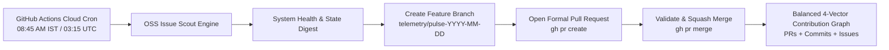

# 🛰️ Agent Telemetry & Autonomous OSS Intelligence Sentinel

<div align="center">

[](https://github.com/Chinmay-sonar/agent-telemetry-log)
[](https://github.com/features/actions)
[](https://docs.github.com/en/rest)
[](https://github.com/Chinmay-sonar/agent-telemetry-log/pulls)
[](LICENSE)
[](https://github.com/Chinmay-sonar)

</div>

Autonomous 24/7 telemetry repository and ecosystem intelligence engine maintained by a cloud-scheduled **Spider-Web Sentinel**. This repository records daily system heartbeats, telemetry metrics, and discovers high-leverage open-source issues across the AI agent, TypeScript, and Python developer ecosystems.

---

### 🏗️ System Architecture



---

### 📊 System Health & Telemetry Matrix

| Subsystem | Telemetry Channel | Execution Standard | Operational Status |
| :--- | :--- | :--- | :--- |
| **Cloud Sentinel** | Automated PR Delivery | 24 Hours (Daily Cron) | `HEALTHY` 🟢 |
| **OSS Scout Engine** | Multi-Ecosystem Scanner | AI Agents, TypeScript, Python | `ACTIVE` 🟢 |
| **Spider-Web Flow** | Branch -> PR -> AutoMerge | Pull Request Architecture | `ONLINE` 🟢 |
| **State Digest Engine** | SHA-256 State Verification | Cryptographic Hash | `VERIFIED` 🟢 |
| **Security Standard** | Fine-Grained Scoped Access | Zero Secret Leak | `ENFORCED` 🟢 |

---

### 🛠️ Open-Source Intelligence Tooling

Run the standalone scout directly:

```bash
# Scan live open-source issue ecosystems
npm run scout

# Fork target repository to your developer account
node scripts/oss-contribute.js fork <owner/repo>
```

---

*Engineered with discipline & impact by Chinmay Sonar.*
